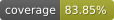

# Leonardo Grigorio Ferreira · Portfolio

 


A short scroll story about where my career is now, not a project showcase.

| Chapter | What happens |
| --- | --- |
| Start | The name in a variable display face (Archivo) cycles word by word behind a blue wipe; letters thin out near the cursor |
| Impact | Pinned before/after counters over a line-drawn clock that ticks and bends around the cursor |
| Path | Horizontal timeline that draws itself over flowing wave lines, ending on the current role, plus a toolkit marquee |
| Contact | Magnetic email link, live São Paulo clock |

Everything respects `prefers-reduced-motion` (static drawings and name, no pinning or scrubbing) and works in Portuguese and English, light and dark. The palette is black and white with one cobalt blue accent, set by `--accent` in [`src/index.css`](src/index.css).

## Stack

React, TypeScript, Vite, Tailwind CSS, Framer Motion, a small canvas line-drawing backdrop, Vitest.

## Editing content

All copy lives in [`src/content/pt.ts`](src/content/pt.ts) and [`src/content/en.ts`](src/content/en.ts) (same shape, enforced by tests). Wrap words in `*asterisks*` to render them in the accent colour. Links are in [`src/content/links.ts`](src/content/links.ts).

```bash
npm install
npm run dev
npm test
```

## Author

[](https://www.linkedin.com/in/leonardo-grigorio-ferreira/)
[](mailto:leo.grigorio16@gmail.com)
